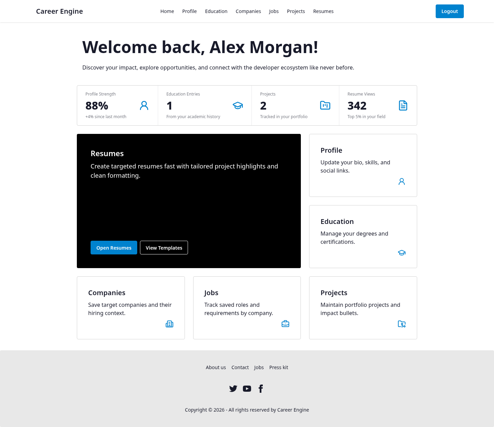
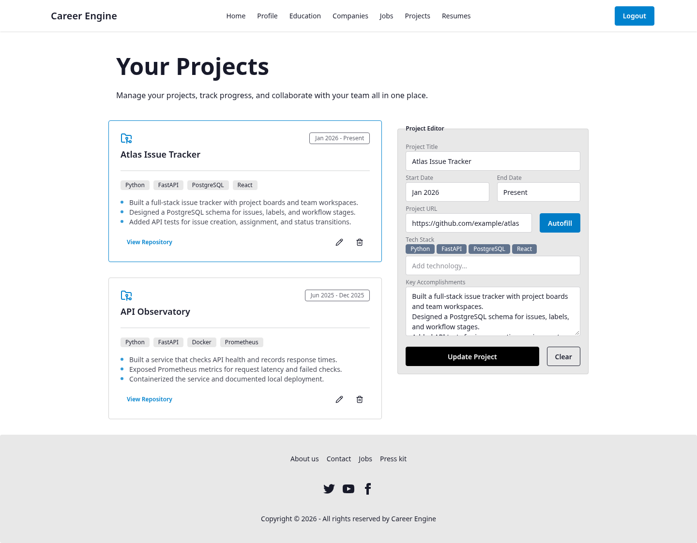
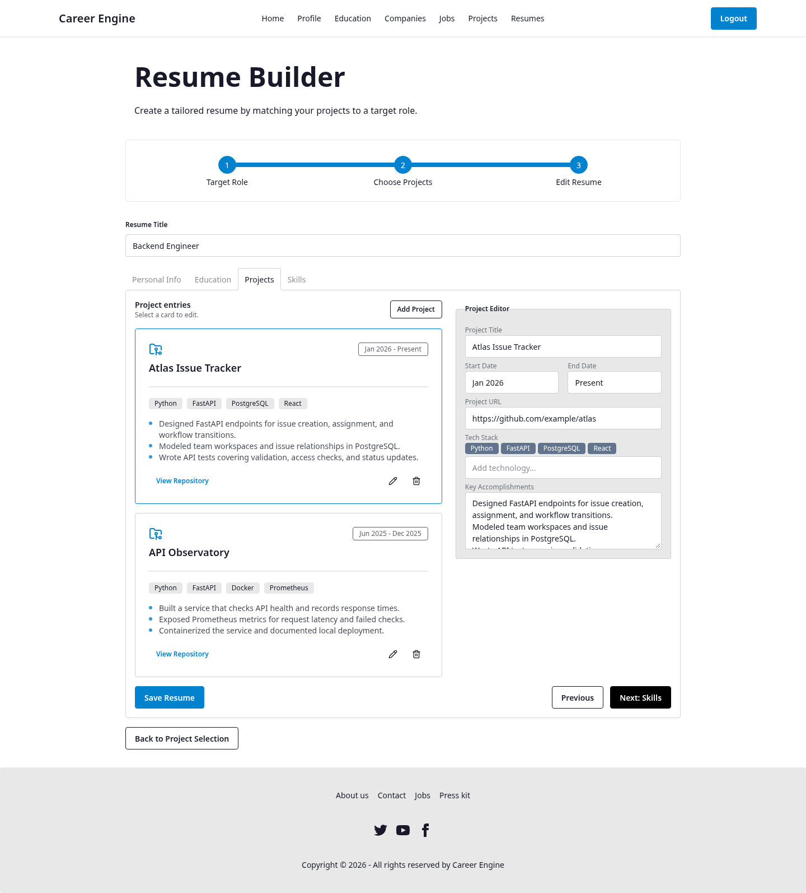
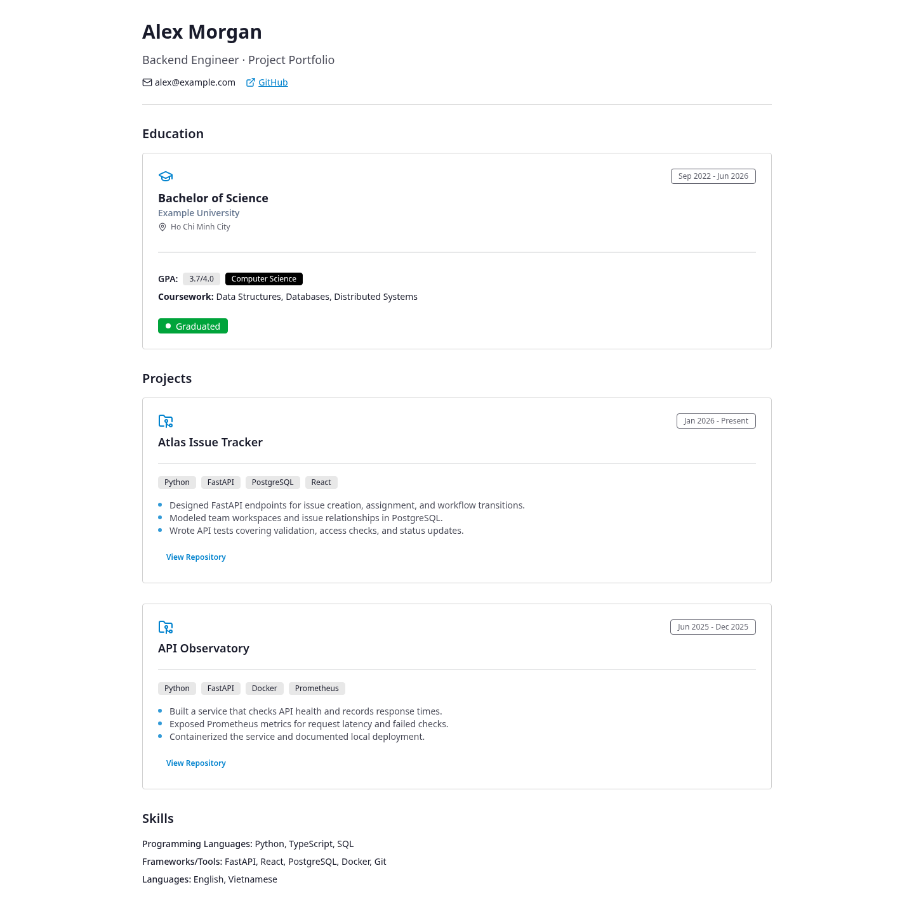
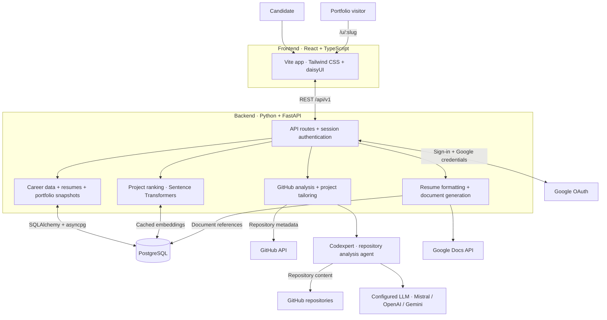

# Career Engine

**Turn your GitHub projects into a tailored resume and a public portfolio.**

Career Engine gives developers one place to organize their career information, analyze their projects, and prepare for a specific role. Save your background once, choose the work that fits each opportunity, and share the result.

[Get started](#run-locally) · [Explore the product](#see-it-in-action) · [Follow a workflow](#from-github-to-a-shareable-portfolio) · [System architecture](#system-architecture)

**Ready to host it?** Follow the [single-VPS deployment guide](docs/DEPLOYMENT.md) for Docker Compose, automatic HTTPS, Google sign-in, and database backups.



*Screenshots show the current app with fictional demo data and mocked API responses. The dashboard's profile-strength and resume-view figures are UI placeholders.*

## Build on the work you've already done

| Feature | What you can do |
| --- | --- |
| Career workspace | Keep your contact information, education, and project history ready to reuse in resumes. |
| GitHub project analysis | Paste a repository URL to suggest a project title, dates, technologies, and three accomplishment bullets. Review and edit before saving. |
| Job tracking | Save companies and roles with descriptions, requirements, application stages, and deadlines. |
| Project matching | See projects ranked by similarity to a saved job, then choose up to five for tailoring. |
| Tailored resumes | Generate project descriptions for the target role. Edit personal information, education, projects, and skills, then save separate resume versions. |
| Public portfolios | Publish selected resume content at `/u/<slug>`. Choose which contact details and entries to share, update publication settings, or unpublish. |
| Google Docs export | Create a formatted Google Doc from a saved resume through the backend API. Regenerating updates the same document. |

## See it in action

### Give your projects a clear story

Use **Autofill** in the project editor to analyze a GitHub repository. Career Engine uses repository evidence to suggest technologies and accomplishment bullets, while GitHub metadata supplies the date range. Refine the suggestions and save them to your project library.



### Prepare a resume for the role

The resume builder walks you through **Target Role → Choose Projects → Edit Resume**. Project matching helps you select relevant work; generation adapts the project descriptions to the job's requirements. Your profile and education carry into the editor so you can focus on reviewing the content and adding your skills.



### Share a portfolio with your chosen details

Publish from a saved resume to create a public page with education, projects, repository links, and skills. Visitors can open it without signing in. Each publication stores a snapshot; edit its settings to refresh the shared content after changing your resume.



## From GitHub to a shareable portfolio

Alex is applying for a Backend Engineer role that calls for Python, FastAPI, and PostgreSQL. Here's one complete workflow:

1. **Build a foundation.** Sign in with Google, fill in **Profile**, and add your academic history under **Education**.
2. **Analyze your work.** Open **Projects**, enter a GitHub repository URL, and select **Autofill**. Check the generated title, dates, stack, and bullets, then select **Save Project**. Repeat for the projects you want to use.
3. **Save the opportunity.** Add the employer under **Companies**. In **Jobs**, save the Backend Engineer role with its description, requirements, stage, and deadline.
4. **Choose relevant projects.** Open **Resumes → Create Resume**, select the saved role, and continue. Review the project match scores and select one to five projects, such as Atlas Issue Tracker and API Observatory in the demo.
5. **Generate and review.** Select **Generate Tailored Projects**. Review the suggested descriptions in **Edit Resume**, check your personal information and education, add skills, and select **Save Resume**.
6. **Publish your selection.** Return to **Resumes**, select **Publish** on the saved resume, choose a slug such as `alex-morgan`, and select the entries and contact details to include. For example, share email and GitHub while hiding phone and address.
7. **Share the result.** Publish and open `/u/alex-morgan` to see the portfolio visitors will receive. Share that URL with your application and update the job's stage as you progress.

For an editable document, the backend also exposes `POST /api/v1/resumes/{resume_id}/generate-doc` with an authenticated session and connected Google credentials. It returns a Google Docs editing URL; this export is currently available through the API.

## System architecture



The frontend uses an HttpOnly session cookie for authenticated API calls. PostgreSQL stores career records, resumes, portfolio snapshots, cached embeddings, and authentication data. Project matching runs in the backend with Sentence Transformers; repository analysis and tailoring use Codexpert with the configured LLM provider. Public portfolio reads return the published snapshot without requiring a session.

## Run locally

Clone the app and its nested submodules:

```bash
git clone --recurse-submodules git@github.com:DPTPhatUS/career-engine.git
cd career-engine
```

Already cloned? Initialize the submodules with `git submodule update --init --recursive`.

1. **Start the backend:** follow the [backend setup guide](https://github.com/DPTPhatUS/career-engine-backend#readme) to install dependencies with `uv`, configure PostgreSQL and Google OAuth, run migrations, and start FastAPI on port `8000`.
2. **Start the frontend:** follow the [frontend setup guide](https://github.com/DPTPhatUS/career-engine-frontend#readme) to install dependencies with `npm ci`, configure `VITE_API_BASE`, and run `npm run dev`.
3. **Connect the services:** set `VITE_API_BASE` to the backend URL and the backend's `FRONTEND_ORIGIN` to the URL printed by Vite. Configure Google's login and reconnect callback URLs to match the backend settings.

Local development needs Node.js/npm, Python 3.12+, `uv`, PostgreSQL, Google OAuth credentials, and a Fernet encryption key. GitHub autofill and project tailoring also need an API key for the selected LLM provider. The setup guides and each submodule's `.env.example` describe the configuration.

For implementation details, see the [frontend API guide](https://github.com/DPTPhatUS/career-engine-frontend/blob/main/docs/API.md) and [backend API guide](https://github.com/DPTPhatUS/career-engine-backend/blob/main/docs/API.md).

